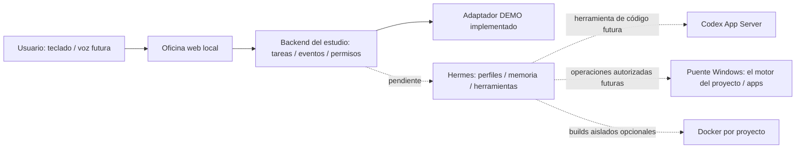

# Arquitectura propuesta y base implementada

## Flujo

La oficina representa agentes y runs; no ejecuta el modelo. Hermes conserva identidad, memoria y herramientas del agente. El backend normaliza eventos y controla qué proyecto, worktree y permisos corresponden a una ejecución. Codex se integra como herramienta programática especializada, sin reemplazar Hermes.

En v0.1 las líneas punteadas no están implementadas. No hay scheduler real, cola durable, autenticación multiusuario ni control de procesos de agentes. La API sólo produce eventos demo. Para tareas durables se evaluará Kanban nativo de Hermes, con un tablero por juego, antes de construir un planificador propio.

## Entorno inicial

| Alternativa | Ventaja | Límite | Uso recomendado |
| --- | --- | --- | --- |
| Windows nativo | Acceso directo al escritorio y a herramientas Windows | Hay que limitar herramientas y escrituras explícitamente | Oficina, Hermes y puente local inicial |
| WSL | Herramientas Linux y automatización CLI | Control de apps Windows añade cruce de procesos/rutas | Sólo si el stack lo necesita |
| Docker Linux | Builds reproducibles, montajes y recursos limitados | No ve ni controla automáticamente las ventanas del host | Verificación y builds aislados por juego |
| Híbrido | Escritorio local + workers CLI limitados | Más componentes y observabilidad | Tras validar el primer flujo real |

La recomendación es una decisión del estudio basada en la necesidad de abrir apps y en el soporte nativo documentado por [Hermes](https://hermes-agent.nousresearch.com/docs/user-guide/windows-native). No implica que todas las herramientas de terceros soporten Windows. Cada integración se prueba por separado. Si un renderer o generador necesita Linux/GPU, se añadirá un worker específico.

## Memoria y fuente de verdad

- Instrucciones: Git, con SOUL.md y configuración revisada. No editar la fuente del perfil desde una conversación sin revisión.
- Memoria operativa: home Hermes por proyecto × agente. Separar también sesiones, autenticación y cachés si el proveedor lo exige.
- Estado de tareas futuro: almacén durable del backend con IDs estables. Los eventos serán proyecciones de runs, no una deducción de lo que diga el modelo.
- Artefactos: archivos/diffs con ruta relativa, SHA y procedencia. El arte generado conserva prompt, modelo/herramienta y licencia cuando corresponda.
- Conversaciones y foto: privadas en rutas ignoradas; no introducirlas en README ni en actividad global.

## Permisos que faltan para el runtime real

Una lista en un JSON o una personalidad no restringe físicamente el acceso. Antes de habilitar terminal, archivos o escritorio, el backend y el ejecutor deberán:

1. Resolver la raíz y el worktree del proyecto, comprobando rutas finales y enlaces. Denegar rutas fuera de ese ámbito.
2. Dar al agente sólo herramientas necesarias. El puente de escritorio tendrá verbos concretos y serializará operaciones; cinco agentes no deben pulsar teclas en paralelo en la misma ventana.
3. Interceptar acciones sensibles: credenciales, publicación, compras, borrado irreversible o cambios fuera del alcance. Conservar el estado de aprobación sin convertir texto del modelo en permiso.
4. Limitar tiempo, coste, concurrencia, profundidad y reintentos. Presupuesto sin configurar impide runs de pago.
5. Propagar cancelar/timeout a Hermes y herramientas, liberar locks y registrar resultados parciales. No reintentar una acción con efectos externos sin clave idempotente.

Los endpoints demo no ejecutan shell ni leen los juegos. El servidor escucha sólo loopback y rechaza Host/Origin ajenos. Esto permite una demo local; no la convierte en un servicio seguro para publicar. Una versión remota requerirá autenticación, TLS y separación del puente host.

## Adaptador Hermes propuesto

Hermes dispone de superficies oficiales HTTP/SSE y TUI gateway JSON-RPC. Evaluar HTTP/SSE como primer transporte, descubrir las capacidades de la versión instalada y verificar una conversación de sólo lectura con home explícito. No raspar la pantalla TUI ni asumir que las rutas demo sean rutas nativas. Añadir streaming sólo al demostrar eventos fiables; un resumen final no puede simular progreso real. [Integración programática oficial](https://hermes-agent.nousresearch.com/docs/developer-guide/programmatic-integration).

Contrato interno deseado (propio, todavía no implementado): `start(task, profile, scope) → runId`, `subscribe(runId) → eventos`, `cancel(runId) → resultado`, `capabilities() → estado comprobado`. La UI seguirá consultando la API del estudio. Los esquemas no pretenden definir la API nativa de Hermes.
