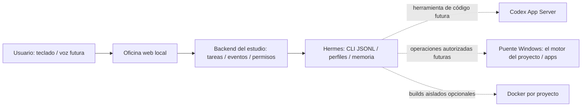

# Arquitectura propuesta y base implementada

## Flujo

La oficina representa agentes y runs; no ejecuta el modelo. Hermes conserva identidad, memoria y herramientas del agente. El backend normaliza eventos y controla qué proyecto, worktree y permisos corresponden a una ejecución. Codex se integra como herramienta programática especializada, sin reemplazar Hermes.

En v0.2 la conversación usa Hermes real mediante el CLI JSONL oficial y eventos SSE del estudio. Las líneas punteadas siguen pendientes. No hay despacho de tareas de juegos, autenticación multiusuario ni control de escritorio. Para tareas durables se evaluará Kanban nativo antes de construir un planificador propio.

En v0.3 el cliente usa SVG para personajes, props y oficina, con animaciones CSS
por rol y soporte de movimiento reducido. Un mundo ampliado comparte geometría
con colisiones, búsqueda de rutas y la cámara. La capa de TV usa imagen/vídeo HTML
en las mismas coordenadas del mundo. El chat móvil es un panel con foco acotado.

`lib/media.mjs` recibe composiciones declarativas del resultado real de Hermes,
valida tipos, coordenadas, colores y tamaño, y construye SVG sin admitir scripts
ni referencias externas. El backend guarda archivos e índice privados, emite
`artifact.created` y enlaza el resultado al chat. Los adjuntos se identifican
por contenido, conservan procedencia distinta y se sirven con rangos HTTP.
El backend no genera vídeo ni ejecuta un renderer de código del modelo.

La v0.4 enlaza los estados `running/idle` de Hermes a postura y posición del
personaje, y a monitor/lámpara del escritorio. La escena no produce estados
autónomos de trabajo. La TV secundaria consulta `lib/codex-usage.mjs`: proceso
Codex App Server por stdio, handshake y únicamente `account/rateLimits/read` y
`account/usage/read`. Normaliza un subconjunto de métricas antes de servir HTTP;
IDs de cuenta/créditos, credenciales y errores originales no se exponen ni guardan.
La caché comparte peticiones durante 60 s, conserva la hora de una lectura vieja
si hay fallo y acota el refresco manual a 15 s. No se crea ningún thread o turn.

## Entorno inicial

| Alternativa | Ventaja | Límite | Uso recomendado |
| --- | --- | --- | --- |
| Windows nativo | Acceso directo al escritorio y a herramientas Windows | Hay que limitar herramientas y escrituras explícitamente | Oficina, Hermes y puente local inicial |
| WSL | Herramientas Linux y automatización CLI | Control de apps Windows añade cruce de procesos/rutas | Sólo si el stack lo necesita |
| Docker Linux | Builds reproducibles, montajes y recursos limitados | No ve ni controla automáticamente las ventanas del host | Verificación y builds aislados por juego |
| Híbrido | Escritorio local + workers CLI limitados | Más componentes y observabilidad | Tras validar el primer flujo real |

La recomendación es una decisión del estudio basada en la necesidad de abrir apps y en el soporte nativo documentado por [Hermes](https://hermes-agent.nousresearch.com/docs/user-guide/windows-native). No implica que todas las herramientas de terceros soporten Windows. Cada integración se prueba por separado. Si un renderer o generador necesita Linux/GPU, se añadirá un worker específico.

## Memoria y fuente de verdad

- Instrucciones: Git, con SOUL.md y configuración revisada. No editar la fuente del perfil desde una conversación sin revisión.
- Memoria operativa: home Hermes por proyecto × agente. Separar también sesiones, autenticación y cachés si el proveedor lo exige.
- Estado de tareas futuro: almacén durable del backend con IDs estables. Los eventos serán proyecciones de runs, no una deducción de lo que diga el modelo.
- Artefactos: archivos/diffs con ruta relativa, SHA y procedencia. El arte generado conserva prompt, modelo/herramienta y licencia cuando corresponda.
- Conversaciones y foto: privadas en rutas ignoradas; no introducirlas en README ni en actividad global.

## Permisos que faltan para el runtime real

Una lista en un JSON o una personalidad no restringe físicamente el acceso. Antes de habilitar terminal, archivos o escritorio, el backend y el ejecutor deberán:

1. Resolver la raíz y el worktree del proyecto, comprobando rutas finales y enlaces. Denegar rutas fuera de ese ámbito.
2. Dar al agente sólo herramientas necesarias. El puente de escritorio tendrá verbos concretos y serializará operaciones; cinco agentes no deben pulsar teclas en paralelo en la misma ventana.
3. Interceptar acciones sensibles: credenciales, publicación, compras, borrado irreversible o cambios fuera del alcance. Conservar el estado de aprobación sin convertir texto del modelo en permiso.
4. Limitar tiempo, coste, concurrencia, profundidad y reintentos. Presupuesto sin configurar impide runs de pago.
5. Propagar cancelar/timeout a Hermes y herramientas, liberar locks y registrar resultados parciales. No reintentar una acción con efectos externos sin clave idempotente.

El endpoint de mensajes inicia únicamente el ejecutable Hermes registrado, con perfil, proveedor y modelo validados, texto por stdin y sin shell. Limita herramientas a memoria y planificación. No expone lectura de juegos ni terminal desde la UI. El servidor escucha sólo loopback y rechaza Host/Origin ajenos. Publicarlo remotamente requeriría autenticación, TLS y una revisión del puente.

## Adaptador Hermes de conversación

`lib/hermes.mjs` consume el protocolo oficial `chat --query-file - --oneshot
--format stream-json`. Sólo acepta frames JSON; los logs humanos no son
respuestas. El gateway nativo de Hermes ejecuta el loop y conserva la sesión.
El backend impone un turno concurrente, fija cuatro iteraciones y comprueba
presupuesto nativo de 90 s, sin fallback de proveedor. El cliente permite 180 s
para transporte y arranque. Una desconexión del CLI puede dejar el turno
nativo ejecutándose hasta su presupuesto; no se acredita cancelación ni se
reintenta automáticamente. La deduplicación no sobrevive un reinicio.

La UI conserva mensajes en `.runtime/hermes-office/`, mientras Hermes mantiene
sus sesiones y memoria en los perfiles nativos. El ID de sesión se usa para
reanudar al mismo agente. La configuración o fallos nunca activan la demo como
fallback. La simulación sólo se usa mediante una selección explícita para
regresión.

El CLI JSONL usa internamente el gateway de la versión instalada. Las superficies oficiales HTTP/SSE y JSON-RPC quedan como alternativas futuras. No se raspa la pantalla TUI ni se interpretan logs como respuestas. [Integración programática oficial](https://hermes-agent.nousresearch.com/docs/developer-guide/programmatic-integration).

Contrato interno deseado (propio, todavía no implementado): `start(task, profile, scope) → runId`, `subscribe(runId) → eventos`, `cancel(runId) → resultado`, `capabilities() → estado comprobado`. La UI seguirá consultando la API del estudio. Los esquemas no pretenden definir la API nativa de Hermes.
